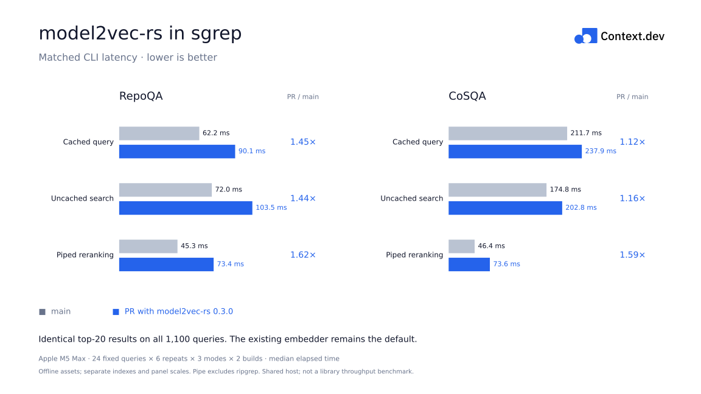
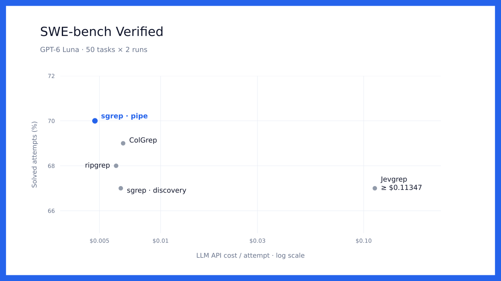
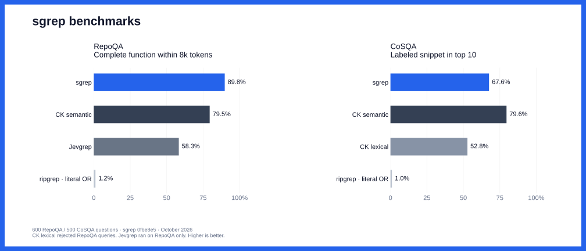
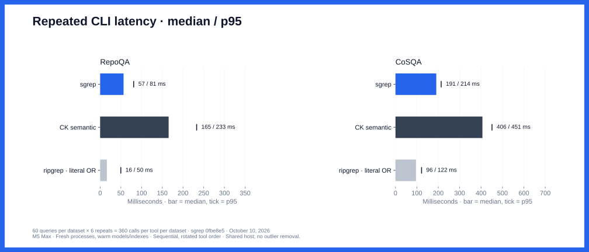
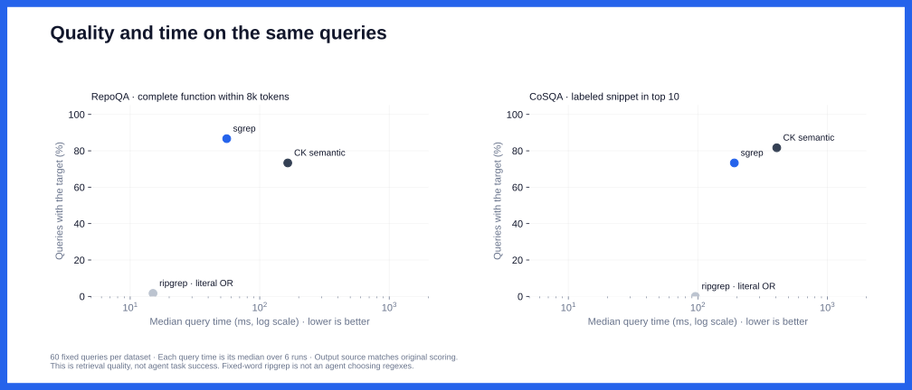
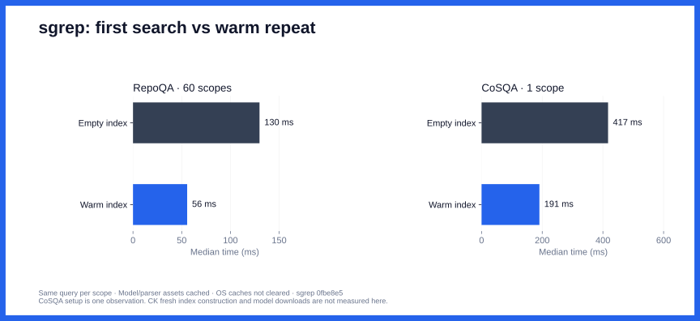
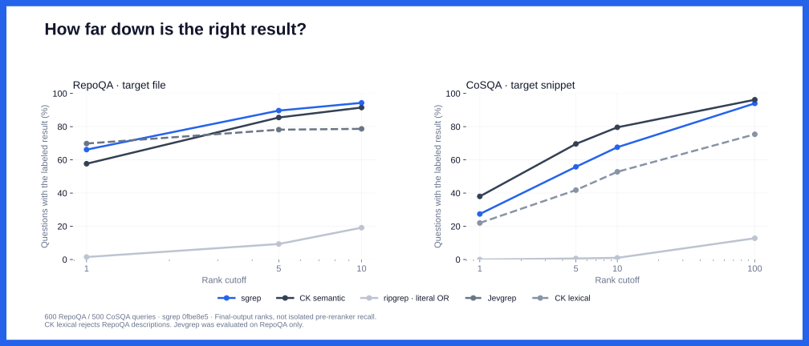
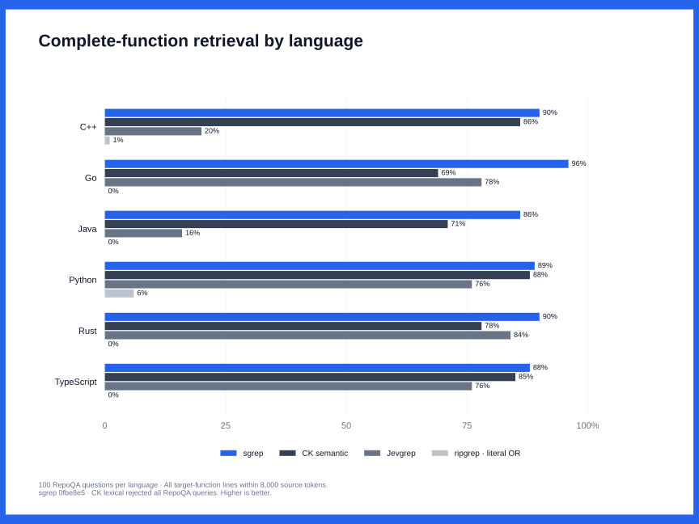

# Code-search benchmark

## model2vec-rs (October 15)



This compares `main` at `dde0c13` with this PR built using `--features model2vec`,
which directly calls Minish Lab's `model2vec-rs` 0.3.0. The optional backend was
slower in this fresh-process CLI workload; the existing embedder remains the default.
This measures the released 0.3.0 implementation, not future releases or in-process library throughput.

| Workload | main median / p95 | model2vec-rs median / p95 | Median change |
| --- | ---: | ---: | ---: |
| RepoQA · Cached query | 62.2 / 89.2 ms | 90.1 / 114.2 ms | +44.7% |
| CoSQA · Cached query | 211.7 / 240.2 ms | 237.9 / 268.3 ms | +12.4% |
| RepoQA · Uncached search | 72.0 / 126.2 ms | 103.5 / 162.0 ms | +43.8% |
| CoSQA · Uncached search | 174.8 / 200.1 ms | 202.8 / 221.3 ms | +16.0% |
| RepoQA · Piped reranking | 45.3 / 50.3 ms | 73.4 / 80.7 ms | +62.0% |
| CoSQA · Piped reranking | 46.4 / 50.6 ms | 73.6 / 80.5 ms | +58.6% |

All **600 RepoQA and 500 CoSQA queries returned identical top-20 ranked source**.
The [36-check receipt](model2vec/compatibility.json) and separate [CLI compatibility checks](../tests/model2vec.py) exercise both models,
long and Unicode input, unknown tokens, piped input, and indexes written by either backend.
Code-model padding and tokenizer truncation are explicitly disabled to preserve existing behavior.
The model files, pinned hashes, offline downloads policy, ranking and cache format are unchanged.

Timing uses two queries per RepoQA language and twelve CoSQA queries, selected by
SHA-256 of the query ID before measurement, with six balanced paired repeats per mode.
The table reports median and p95 over 72 calls per dataset/mode/build. Both builds use
Rust 1.97.1, the normal release profile with thin LTO, and the same Apple M5 Max.
Assets and the operating-system file cache are warm. Cached queries use independent
prepared indexes; uncached searches use `--no-cache`; piped reranking uses the same
precomputed ripgrep input and excludes the producer. Every call starts a new CLI process. Timings use the code model; the text model is covered by compatibility checks only.
No outliers were removed. Repeats are not independent queries; this is a small timing
panel on a shared macOS host, not a universal speed claim or a new retrieval-quality score.

The current native embedder decodes only token vectors needed for a call. The optional
backend loads the full table as f32 on every process invocation and computes tokenizer
metadata. Its encoding runs in parallel batches of 32, but that does not remove startup
work. It also brings its own tokenizer and tensor-library versions as optional dependencies.

[Measured results](model2vec/results.json) retain every elapsed time and output hash.
[Build provenance](model2vec/build.json) pins the baseline, source hashes, compiler,
flags and binary build commands. The runner saves full stdout/stderr separately.

<details>
<summary>Reproduce the comparison</summary>

Build the baseline and candidate with the same compiler and release settings:

```sh
git worktree add /tmp/sgrep-model2vec-before dde0c13
cargo build --manifest-path /tmp/sgrep-model2vec-before/Cargo.toml --release --locked
cargo build --release --locked --features model2vec
python3 tests/model2vec.py /tmp/sgrep-model2vec-before/target/release/sgrep target/release/sgrep /tmp/compatibility.json
python3 benchmarks/model2vec/run.py /tmp/sgrep-model2vec-before/target/release/sgrep target/release/sgrep /path/to/evidence-bundle /path/to/new-output
```

The runner uses the same locally retained RepoQA/CoSQA corpus, queries and manifests
as the October 9 benchmark. The checked-in timing receipt is sufficient to redraw the
chart, but not to rerun searches without that bundle. Models and parsers must already
be cached: the run forces offline mode and verifies source hashes before and after.
The output directory must be new; failures retain native outputs and partial timings.

To redraw the chart without model calls, install `matplotlib==3.11.2` and run
`python3 benchmarks/model2vec/plot.py`. To use a new measurement, first copy its
`results.json` into `benchmarks/model2vec/` and review all parity checks and provenance.

</details>

## SWE-bench Verified (October 13)



The same GPT-6 Luna agent (medium reasoning) attempted **50 tasks across 12 repositories, twice per configuration**. Official SWE-bench patch/test grading scored every attempt. Piped sgrep reduced mean LLM API cost by **21.3%** versus ripgrep, solving **70/100 versus 68/100** attempts. The paired accuracy difference was +2 percentage points (95% task-bootstrap interval: −3 to +8). This supports the prespecified five-point loss margin on this sample; it does not establish improved or exactly equal accuracy.

| Configuration | Solved / 100 | Mean LLM API cost | Chart |
| --- | ---: | ---: | --- |
| sgrep · pipe | 70 | $0.00475 | Included |
| ripgrep | 68 | $0.00604 | Included |
| ColGrep | 69 | $0.00654 | Included |
| sgrep · discovery | 67 | $0.00637 | Included |
| Jevgrep | 67 | ≥ $0.11347 | Included; lower-bound cost |
| CK semantic | 25 | $0.00366 | Omitted: 57 index setup failures |
| CK hybrid | 27 | $0.00348 | Omitted: 58 index setup failures |
| ColGrep agent | 62 | $0.00392 | Omitted: 46 search timeouts |

<details>
<summary>Method, exclusions and limitations</summary>

The chart omits whole configurations with setup failures or search timeouts, retaining all 100 attempts in every shown configuration. Cheap failed setup is not a cost-effectiveness win. Jevgrep had three retrieval network failures without usage receipts across two attempts, so its cost is a lower bound. All eight configurations remain in the recorded results.

Cost includes coding and retrieval LLM calls, actual cache reads/writes, output and reasoning tokens. Machine and grading costs are excluded. Each attempt has a private prompt namespace, repository index and query cache; immutable model downloads are shared. Every agent-start's first model call reported zero cached input. ColGrep agent's local inference has no API charge; its machine cost is not represented.

Pipe mode uses `rg --json -C 3` followed by `sgrep --stdin -n 20`. Discovery is the separate persistent-index mode. Agents choose their own queries: pairing is by task, not identical query replay. There is no matched-output-length ablation. The repository-diverse sample is not an unbiased full-leaderboard estimate; public training overlap is unaudited. Both repeats count. The graph shows point estimates; small vertical differences do not establish superiority.

This is one agent policy on four-core, 8 GiB Linux CPU sandboxes. Latency remains in the results. The first 667 attempts used 32 workers; the last 133 previously unstarted attempts used 16 after an admission-reserve stop. No started attempt was repeated. Earlier infrastructure batches were excluded in full. Fifteen flagged passing patches still passed after removing test edits and temporary files in a separate grading check.

</details>

<details>
<summary>Benchmark code, results and reproduction</summary>

- [Historical agent harness](swe-bench/harness/run_benchmark.py), [native adapters](swe-bench/harness/remote_search.py), [retrieval metering](swe-bench/harness/jev-meter.mjs), [image controls](swe-bench/harness/audit_prepared_images.py), and [analysis](swe-bench/harness/analyze.py).
- [All 800 attempts](swe-bench/results/attempts.csv), [search timings](swe-bench/results/searches.csv), [model usage](swe-bench/results/model-requests.csv), and [aggregates with paired intervals](swe-bench/results/analysis.json).
- [Frozen protocol](swe-bench/harness/PROTOCOL.md), [source/configuration hashes](swe-bench/harness/frozen-manifest.json), [agent-safe tasks](swe-bench/harness/tasks.json), and [evaluator-only data](swe-bench/harness/selected-evaluator-only.json).

Frozen files preserve the measured implementation byte for byte. Evaluator inputs come from [SWE-bench Verified](https://huggingface.co/datasets/SWE-bench/SWE-bench_Verified); never expose gold patches or hidden tests to the agent. Only the excluded smoke task is retained in `dataset-current-evaluator-only.json`. The repository contains derived ledgers, not raw model transcripts, patches or grader logs. CSV references to `runs/` point into the separately retained original evidence archive (SHA-256 `886f12e4d38050c5fc269c98711181771a71ba23debdc30215dd9b3612ccdc73`), not files in this checkout.

**Rebuild the chart without paid calls**, from the repository root:

```sh
uv venv benchmarks/swe-bench/.venv --python 3.12
uv pip install --python benchmarks/swe-bench/.venv/bin/python matplotlib==3.11.2
benchmarks/swe-bench/.venv/bin/python benchmarks/swe-bench/plot.py
```

The renderer validates all 800 attempt records against the aggregates, then writes `benchmark.svg` and `benchmark.png`. It needs no keys or cloud access.

**A new paid study** requires Modal authentication and OpenAI/TypeSafe credentials. This is a historical snapshot: verify model availability, API prices and downloaded asset versions before rerunning. The original cloud resources were deleted; publication did not rerun paid inference. Create an independent copy with unique resource and prompt-cache names:

```sh
python3 benchmarks/swe-bench/prepare_run.py /tmp/sgrep-swe-run --run-id my-unique-study
cd /tmp/sgrep-swe-run
uv venv .venv --python 3.12
uv pip install --python .venv/bin/python -r requirements.txt
.venv/bin/modal setup
git clone https://github.com/context-dot-dev/sgrep.git vendor/sgrep
git -C vendor/sgrep checkout b144e7b5711b2e8bc29125d6cf96c51170505d96
```

Place keys in `/tmp/sgrep-benchmark-secrets/openai-key` and `/tmp/sgrep-benchmark-secrets/typesafe_api_key`, with directory mode `0700` and file mode `0600`, outside the study and repository. The namespace helper verifies frozen hashes before copying; `rerun.json` records its changes. Never reuse an earlier run's outputs or control receipts.

```sh
.venv/bin/python build_tools.py
.venv/bin/python prepare_assets.py
.venv/bin/python update-ripgrep.py
.venv/bin/python audit_prepared_images.py
.venv/bin/python native_adapter_matrix.py
.venv/bin/python preflight.py
```

Require successful build/asset receipts, all 50 prepared-image controls, both native adapter checks and all 50 preflight eligibility flags. Compare native versions/hashes with `native-tool-hashes.json`. Do not drop tasks whose controls fail. Keep the controller process alive throughout execution:

```sh
.venv/bin/python run_benchmark.py --smoke --workers 4
.venv/bin/python run_benchmark.py --pilot --workers 4
.venv/bin/python run_benchmark.py --workers 16
.venv/bin/python analyze.py
```

Inspect smoke/pilot receipts before scoring. Defaults run all eight configurations twice. The $270 admission threshold includes estimated compute and reserves; it is not a provider billing limit. In-flight calls can overshoot. Completed attempts are skipped; interrupted attempts refuse automatic duplication. If the reservation guard leaves jobs unstarted, resume them after active attempts finish. Confirm 800 unique results before claiming completion. `analyze.py` reads raw `runs/` and writes new tables beside the harness; it does not read the historical `results/` directory. Keep new results separate from this chart. These commands run the controller on the caller's host; the original used a persistent cloud controller, so request and host-observed timings may differ.

After preserving evidence, terminate remaining study sandboxes, delete its model-assets volume and remove temporary credential files. No paid calls are needed to reproduce the published graphic.

</details>

## Full retrieval benchmark (October 9, 2026)

600 RepoQA questions. 500 CoSQA questions. sgrep main at `0fbe8e5`, compared with CK, Jevgrep, and ripgrep.



RepoQA measures whether results contain the full target function within 8,000 source tokens. CoSQA measures whether the labeled snippet appears in the first ten results.

## Latency



120 fixed queries, six repeats, and 2,160 timed CLI calls. Models and indexes are warm. Median and p95 include process startup.

<details>
<summary>Sampling and timing</summary>

A separate replay on October 10 uses 60 RepoQA queries and 60 CoSQA queries, with six repeats per tool.
One query is selected by its ID's SHA-256 hash from each RepoQA repository; CoSQA uses the lowest 60 ID hashes.
Each call starts a new CLI process. The timed calls follow a preparation pass, with models and indexes cached.

Tool order rotates within each query. Dataset calls alternate, and query order changes each round.
All 2,160 timed calls run sequentially. No slow samples are removed.
This measures local end-to-end CLI time, including source checks and output, on a shared M5 Max.
It does not isolate embedding time or clear the operating system's cache.

</details>

CK lexical is omitted from this timing replay because it rejects the RepoQA descriptions.
Jevgrep's earlier concurrent, hosted timings are separate. mgrep is not measured; no authenticated installation was available.



Each point uses the same queries for quality and time. Quality comes from the saved scores; repeated outputs must match the same ranked source.
The time axis uses each query's median across six repeats, then the median across queries.
Ripgrep uses fixed query words, so this does not measure an agent choosing regexes.

<details>
<summary>Timing uncertainty and setup</summary>

The [latency analysis](full-suite/latency-analysis.json) reports paired time ratios and 95% bootstrap intervals.
It resamples the 60 query IDs, after collapsing repeats to per-query medians. It does not treat 360 calls as 360 independent queries.
These intervals describe this panel, not other machines or workloads.



Setup here means the first sgrep search in each scope with an empty index and cached model/parser assets.
RepoQA has 60 scopes; CoSQA has one. The CoSQA setup value is one observation, not a tail estimate.
CK reused existing indexes, so its fresh-build cost is not measured. First-time downloads and post-edit latency also need separate runs.
See [index storage and API usage](full-suite/setup-summary.json) for the earlier full run.

</details>

## Rank



On CoSQA, 132 of sgrep's 162 top-ten misses appear at ranks 11–100. Better ranking could help. This does not measure recall before reranking.

## Languages



100 questions per language. The target function must fit within 8,000 returned source tokens.

## What this measures

Keep four questions separate: did search find the target, did it return enough source, how long did it take, and what did setup cost?
A fast miss is still a miss. File rank alone does not show whether an agent has enough code to act.

This suite covers natural-language code discovery. It does not yet compare exact-name search, agent-chosen regexes, piped ranking, prose retrieval, or complete coding tasks.
Code and document modes therefore share no headline quality claim.

## Method

RepoQA uses all 60 supplied source snapshots. CoSQA uses all 500 test questions and 6,267 Python snippets.
The RepoQA measure adapts the dataset for retrieval; it is not the official code-generation score.
CoSQA has one labeled answer per question, so other valid answers may count as misses.
Both datasets were used during development.

CK lexical rejected all RepoQA queries and six CoSQA queries. These failures count as misses.
Jevgrep ran on RepoQA only; six partial searches remain included.
Ripgrep used a fixed literal-OR query, not patterns chosen by a person or agent.

<details>
<summary>Run details</summary>

- sgrep used `--model code --json`, with up to 50 passages on RepoQA and 100 on CoSQA.
- CK 0.7.11 used `bge-small`, native semantic or lexical search, and `--full-section --threshold 0`.
- Jevgrep used commit `703aba1` and TypeSafe `jev-1.13.0`. It had four query workers, a 180-second timeout, and a 1,000-request cap.
- ripgrep 15.2.0 matched query words without case sensitivity and sorted results by path.
- File ranks count distinct files. Source coverage uses `o200k` tokens and counts overlapping lines once.

Source hashes and returned lines were checked before publication. CK semantic omitted four target-query files; these count as misses.
Thirty Jevgrep searches were repeated after host sleep affected their clocks. All CK lexical searches were repeated after copied indexes were rebuilt.
These fixes did not select queries by score. Original attempts remain in the local evidence archive.

The original full-suite timing used one fresh process per query. Methods rotated; the CK lexical rerun ran separately.
Those single-pass timings remain in the CSV. The latency chart above uses the separate repeated panel.
The original rotation included another baseline that is omitted here. Full CK index build time was not measured.
See the [protocol](full-suite/protocol.json), [setup and usage](full-suite/setup-summary.json), and [paired comparisons](full-suite/paired-comparisons.json).

</details>

[Quality CSV](full-suite/summary.csv) · [5,000 scored runs](full-suite/results.json) · [Repeated latency samples](full-suite/latency-replay.json)

To check the totals and redraw the charts:

```sh
python3 benchmarks/full-suite/verify.py
# Requires matplotlib:
python3 benchmarks/full-suite/plot.py
```

This checks saved scores and timing summaries. It does not rerun the search tools.

<details>
<summary>Repeat the latency experiment</summary>

```sh
python3 benchmarks/full-suite/replay_latency.py /path/to/evidence-bundle /path/to/new-output
python3 benchmarks/full-suite/analyze_latency.py
```

The runner needs the original corpus, query, manifest, protocol, and native-record files. Set binary paths in that bundle's protocol for your machine.
Copied bundles also need their recorded absolute source paths remapped.
The bundle is retained locally; the checked-in receipt alone is not enough to rerun searches.
The runner checks pinned binaries and source hashes, saves its query selection before timing, and retains every native output.
It records errors, host load, clock gaps, and changes to ranked source. Review these before publishing a new receipt.
The analysis script reads the checked-in latency receipt; copy a validated new receipt there to analyze another run.

</details>

[Earlier measurements](https://github.com/context-dot-dev/sgrep/blob/cfb48d90c88cb92363b7b7e1a6403f575dc7dbc5/benchmarks/README.md#historical-measurements) use older builds, samples, and metrics.
